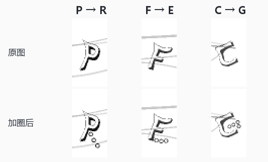

# 空心圆字母伪装的模型盲测与合并建议

v2.2.0 已采纳默认关闭的建议，`letterMimicProbability` 的发布默认值为 `0`。下文的默认组记录的是评测提交 `090d6a9` 使用 `0.5` 时的结果。

**建议暂缓按当前默认值合入主分支。** 小圈能诱发预期的字母误读，效果随字母和模型变化。修正后的 32 道定向题全部带有伪装，Sol 仍通过了 27 道。默认概率下，三个模型整题通过数下降的幅度与独立重复读图的波动接近。本轮没有测量真人通过率。

## 实现与审查

实现和两项独立审查均使用 GPT-6.2-Sol xhigh。基线是 `9d2e7d1`，首版是 `7f1fc5d`，复审和最终重放使用 `090d6a9`。平面 PNG 接口 `createStrong()` 按 `letterMimicProbability` 逐题决定是否尝试伪装。默认值为 `0.5`，`0` 关闭，`1` 每题尝试。每题最多给一个字母添加三个或四个空心圆。服务端按实线字母判题。[中文配置说明](../../../README_CN.md)

### 工程规范审查（Standards）

首轮发现大字号下的圆环间距过远，以及候选字形轮廓被重复扫描。修正后，渲染器会跳过无法形成连续笔画的布局，放置小圈时共用一次字形扫描来判断可见性和计算碰撞。复审确认这两项已解决。Node.js 24.20.0 下 48 项测试通过，发布包清单包含新渲染模块。

### 需求审查（Spec）

首轮发现小圈可能突破 `balanced`、`beaded` 对字形中部干扰数量的限制，且 C 的几何规则可能只画一排点。修正后，两种受保护的样式会避开所有字形的核心区域，C 只有在四个小圈能同时画出横笔和向下的折笔时才尝试模拟 G。复审代理采样的 121 个 C 伪装均包含折笔，两种受保护样式中实际出现的 50 个伪装均未碰到字形核心。两项审查各有两项初审发现，最终均无待修事项。

## 最终版整题通过率

后续用 256 道全新随机题直接对比了概率 `0` 和 `1`。开启后，Luna、Terra、Sol 的整题通过率分别下降 5.1、2.3、3.5 个百分点。[开关对照测试与逐题记录](switch-ab/README.md)

表内数值为答对整串六个字母的题数。默认组直接抽取 48 个不同答案，其中 7 个实际画出了小圈。定向组指定尝试概率为 1，按实际画出的字母收集 16 个 P、8 个 F 和 8 个 C，共 32 个不同答案。

| 图像条件 | GPT-6 Luna | GPT-6.1 Terra | GPT-6.2 Sol |
| --- | ---: | ---: | ---: |
| 默认组，同底图关闭伪装 | 14/48（29.2%） | 39/48（81.3%） | 40/48（83.3%） |
| 默认组，按 0.5 尝试 | 12/48（25.0%） | 37/48（77.1%） | 36/48（75.0%） |
| 定向组，同底图关闭伪装 | 11/32（34.4%） | 23/32（71.9%） | 29/32（90.6%） |
| 定向组，实际画出伪装 | 9/32（28.1%） | 20/32（62.5%） | 27/32（84.4%） |

默认组的 41 对图片像素完全相同。两次独立读图时，Luna 在这 41 题中通过 14 → 12 道，Terra 通过 34 → 33 道，Sol 通过 34 → 31 道。Sol 默认组少通过的 4 道里，净差 3 道来自相同像素。在实际发生变化的 7 对中，三个模型的整题结果分别为 0 → 0、5 → 4、6 → 5。默认组的整题差异不足以证明小圈能稳定降低通过率。

## 是否读成了指定的另一个字母

以下只看定向组的伪装位置。同一批底图关闭伪装后，三个模型读成指定目标字母的次数均为 0。

| 小圈模拟的笔画 | 定向题数 | Luna 读成目标 | Terra 读成目标 | Sol 读成目标 |
| --- | ---: | ---: | ---: | ---: |
| P → R 的斜腿 | 16 | 2 | 0 | 1 |
| F → E 的底横 | 8 | 2 | 0 | 1 |
| C → G 的内横和折笔 | 8 | 6 | 3 | 0 |
| 合计 | 32 | 10 | 3 | 2 |

在 32 个伪装位置上，Luna 读对原字母的次数从 31 降至 18，Terra 从 32 降至 29，Sol 从 32 降至 30。Luna 和 Terra 最常被 C → G 误导；Sol 在这 8 个 C 上全部读对。每种映射只有 8 或 16 道定向题，不能据此推算线上效果。

## 默认生成时出现小圈的频率

在最终提交上另做两组独立抽样，每组 512 张。对每张 PNG 回放相同随机输入，解码并对比关闭伪装时的 RGB 像素。

| 六位字符集 | 含有 P、F 或 C 的题数 | 实际画出小圈 | 按 P / F / C 拆分 |
| --- | ---: | ---: | --- |
| 26 个大写英文字母 | 252/512 | 65/512（12.7%） | 22 / 20 / 23 |
| `createStrong()` 自带的字母数字字符集 | 256/512 | 79/512（15.4%） | 29 / 25 / 25 |

## 盲测口径与复核

- 使用内置字体，六个大写字母，210 × 68 像素，三条噪线，默认配色。每对图共享答案、字体变形、噪线、位置和颜色。使用公开入口和相同随机输入生成关闭伪装的对照图，并逐张验证它与基线提交的输出字节一致。
- 每个模型使用两份独立上下文。每一份只看每对中的一张图，各组在两份中均衡分配开关条件，再分别打乱顺序。三个模型看到相同的题图，六份作答均在揭晓前完成。每个模型共读 160 张，合计 480 次整题作答。三个读图模型均未显式指定推理档位。
- 代理按统一提示从左向右读取连续实线构成的六个大写字母。只提供带中性编号、二倍最近邻放大的 PNG 题页，按指令隔离评测材料。没有提供源码、答案、组别或正确性反馈，也未使用 OCR。共享文件系统的隔离依赖代理遵守指令。
- 最终提交重放了所有 160 张盲测图片的 SHA-256。结果文件包含每个编号的答案、两幅图的哈希、发生像素变化的位置、原始预测、逐组计数与配对统计。两轮的 40 张题页哈希和 960 份作答均经过独立汇总复核。[最终逐题结果](results.json) · [第一份题页](one/sheet-01.png) · [第二份题页](two/sheet-01.png)
- 首轮对初版另测 80 对图片。定向组的整题通过数为 Luna 16 → 8、Terra 26 → 21、Sol 26 → 25。修正字号、受保护字形和 C 的折笔后，最终轮重新生成全部题目。两轮独立列示，不合并计分。[首轮逐题结果](initial/results.json)

如需先合入实验能力，建议把默认概率改为 `0`，由接入方显式启用随机伪装。默认开启前，使用同底图对照测量真人首次通过率和作答时间，再判断这些误读是否值得引入。
